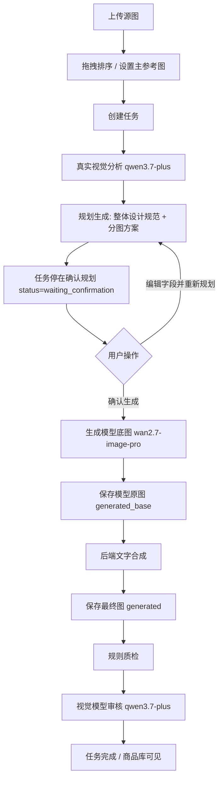

# 全品类商品图质量升级实施规划

日期：2026-07-16  
适用功能：前台「AI 全品类商品图」的主图与详情图生成  
规划结论：采用「分阶段完整升级」方案，先把真实视觉分析、可确认规划、文字合成和质检链路跑通，再进入更高级的广告图、自动重生和画布能力。

## 1. 目标与边界

### 1.1 本次目标

把现有「全品类商品图」从“上传图片后自动生成”升级为更接近对标平台的商品视觉生产流程：

1. 用户上传 1-6 张商品图后，可以拖拽排序并明确主参考图。
2. 后端使用真实视觉理解模型分析商品，不再把图片 URL 当普通文本塞给文本模型。
3. AI 先输出可读、可编辑的「整体设计规范」和「分图方案」，任务停在确认规划节点。
4. 用户可以编辑自然语言字段，默认复用视觉分析结果重新规划。
5. 用户确认后再生成图片。
6. 生成模型主要负责无字或少字底图，中文标题、卖点、短文案由后端确定性排版合成。
7. 后台同时保留模型原图和最终合成图，前台只展示、下载最终合成图。
8. 每次生成后默认执行规则质检和视觉模型审核，审核失败不阻塞完成，但要展示风险状态和原因。
9. 输出资产继续进入 OSS 和商品库，保留模型、提示词、参数、任务、审核结果，满足可追溯和复用。

### 1.2 本次不做

1. 不做积分、扣点、套餐、支付、租户、团队空间，符合项目宪法的一期边界。
2. 不做广告图完整工作流；广告图只写入后续路线图。
3. 不做高级通用画布；本次文字合成只做固定模板和轻量配置。
4. 不让前台用户直接编辑原始生图提示词，用户只编辑可理解字段，后端负责组装最终提示词。
5. 不把模型临时 URL 暴露为最终资产；所有最终可用图片必须进入 OSS。

## 2. 已确认产品决策

| 决策项 | 结论 |
|---|---|
| 升级范围 | 主图 + 详情图一起升级 |
| 视觉理解 | 增加真实视觉理解模型 |
| 视觉模型路线 | 使用模型网关抽象，首个实现为阿里 DashScope OpenAI 兼容接口 |
| 首选视觉模型 | `qwen3.7-plus` |
| 任务流 | 创建任务后只跑到「确认规划」，用户确认后再生成 |
| 规划编辑 | 只开放自然语言字段，不开放原始提示词编辑 |
| 重新规划 | 默认复用已有视觉分析结果，只重新生成规划 |
| 图片文字 | 主图必做后端文字合成；详情图仅在规划明确有文案时合成 |
| 展示策略 | 后台保留模型原图和最终合成图，前台只展示最终合成图 |
| 质检策略 | 规则质检 + 视觉模型审核默认每次执行 |
| 审核阻塞 | 非阻塞完成；页面展示审核状态、风险和原因 |
| 提示词模板 | 生成新版模板文档，用户手动复制到后台提示词管理 |
| 执行节奏 | 用户批准本规划后，后续按阶段自动执行，每阶段报告测试结果 |

## 3. 对标能力拆解

对标平台的优势不只是“提示词更长”，而是工作流多了几个关键中间层：

1. 源图管理更明确：上传图有编号、主参考图、数量提示和排序感。
2. 视觉分析更真实：先理解商品、视角、材质、颜色、品牌元素和风险边界。
3. 设计规范更完整：风格关键词、情绪关键词、光影、色彩、字体、视觉元素统一规划。
4. 分图方案更商业化：每张图有标题、设计目标、构图、背景、元素、文案和禁忌。
5. 确认节点更强：生成前让用户看懂并编辑方案，而不是直接跑图。
6. 文字策略更稳：电商主图上的中文短文案需要可控排版，不能完全交给生图模型画字。
7. 质量闭环更完整：生成后需要判断商品是否变形、改色、错 logo、乱写字、虚假卖点。

本项目当前的主要差距：

1. `AiProductImageTaskServiceImpl.runAnalysisStage` 当前调用文本生成，并把源图 URL 拼成字符串，视觉分析不是真正看图。
2. `确认规划` 当前只是一个节点名，任务会自动继续进入生成阶段，用户不能编辑确认。
3. `planning_output` 结构太薄，缺少整体设计规范、分图方案、文案排版和质检约束。
4. 前端结果区目前展示 JSON，缺少对标式的可读规划卡片。
5. 图片表只有 `source` 和 `generated`，不能区分模型原图与最终合成图。
6. 生成后没有默认视觉审核，风险不能稳定反馈到商品库和任务中心。

## 4. 阿里官方参数边界

本规划依据以下阿里云官方文档设计，实施时只按官方支持字段传参：

1. [通义千问视觉理解](https://help.aliyun.com/zh/model-studio/vision)
2. [OpenAI 兼容 Chat Completions](https://help.aliyun.com/zh/model-studio/qwen-api-via-openai-chat-completions)
3. [视觉推理模型使用建议](https://help.aliyun.com/zh/model-studio/visual-reasoning)
4. [结构化输出 / JSON Mode](https://help.aliyun.com/zh/model-studio/qwen-structured-output)
5. [通义万相文生图 / 图像生成](https://help.aliyun.com/zh/model-studio/text-to-image)

### 4.1 `qwen3.7-plus` 视觉理解调用规则

默认使用 DashScope OpenAI 兼容接口：

```text
POST https://dashscope.aliyuncs.com/compatible-mode/v1/chat/completions
Authorization: Bearer ${EGG_DASHSCOPE_API_KEY}
Content-Type: application/json
```

允许传入：

1. `model`: 默认 `qwen3.7-plus`。
2. `messages`: 支持 `system`、`user` 等角色消息；`system` 是一条消息，不是顶层 `system` 参数。
3. `messages[].content`: 视觉输入用多模态数组，包含图片 URL 和文本指令。
4. `response_format: {"type":"json_object"}`：用于要求稳定 JSON 输出，提示词正文必须明确包含 JSON 输出要求。
5. `stream`: 本次视觉分析、规划和审核先不用流式。
6. `vl_high_resolution_images`: 需要高分辨率看细节时可启用。

不能或不建议传入：

1. 不传非官方的顶层 `system_prompt`、`systemPrompt`、`negative_prompt`、`image` 等自造字段。
2. 启用 `vl_high_resolution_images=true` 时不再同时传 `max_pixels`；未启用高分辨率时才考虑 `max_pixels`。
3. 视觉分析的关键输出格式、约束和 JSON schema 要放在 user message 文本里；复杂场景可以保留简短 `system` 角色，但不要只依赖 system message。
4. 图片不要传本地路径或二进制，传后端生成的 OSS 签名 URL。

### 4.2 `wan2.7-image-pro` 图片生成调用规则

继续使用 DashScope 图片生成异步接口：

```text
POST https://dashscope.aliyuncs.com/api/v1/services/aigc/image-generation/generation
Header: X-DashScope-Async: enable
```

允许传入：

1. `model`: 默认 `wan2.7-image-pro`。
2. `input.messages[0].content[].text`: 合并后的正向生图提示词。
3. `input.messages[0].content[].image`: 参考图 URL。
4. `parameters.size`: 例如 `768*1024`、`1024*1024`。
5. `parameters.n`: 主图 1-4，详情图逐张生成，单次请求为 1。
6. `parameters.enable_sequential`: 本次默认 `false`。
7. `parameters.watermark`: 明确传 `false`，避免最终资产带模型水印。
8. `parameters.color_palette`、`thinking_mode`: 后续需要时再接入，本次不作为第一阶段必需项。

不能传入：

1. 不传 `negative_prompt` 参数；官方说明 `wan2.7-image-pro` 不支持。负向约束要写进 `text` 提示词正文。
2. 不传 `prompt_extend` 参数；官方说明 `wan2.7-image-pro` 不支持。
3. 不要求模型直接生成稳定中文商业文案；中文文案由后端合成。

## 5. 目标工作流



节点状态建议：

| current_node | status | 含义 |
|---|---|---|
| `输入` | `processing` | 任务刚创建，准备进入后台执行 |
| `分析中` | `processing` | 正在进行真实视觉分析 |
| `确认规划` | `waiting_confirmation` | 规划已生成，等待用户确认或重新规划 |
| `确认规划` | `processing` | 用户触发重新规划，后台正在刷新规划 |
| `生成中` | `processing` | 已确认，正在生成底图、合成文字和审核 |
| `完成` | `completed` | 最终合成图已保存，审核结果已写入或标记失败 |
| 任意节点 | `failed` | 当前节点失败，可重试 |
| 任意节点 | `cancelled` | 用户终止任务 |

## 6. 数据设计

### 6.1 尽量复用现有表

现有表已经具备宽 JSON 字段，本次优先复用：

1. `ai_product_image_tasks.analysis_output`: 保存真实视觉分析 JSON。
2. `ai_product_image_tasks.planning_output`: 保存整体设计规范、分图方案、用户编辑记录和最终生图提示词包。
3. `ai_product_image_tasks.generation_output`: 保存模型原图、最终合成图、规则质检、视觉审核结果。
4. `ai_product_image_tasks.debug_prompts`: 保存渲染后的视觉分析、规划、生图、审核请求摘要。
5. `ai_product_image_tasks.model_params`: 保存主参考图、参考图顺序、确认时间、模型参数快照。

### 6.2 图片角色规范

不新增图片表字段，改用 `image_role` 规范：

| image_role | 是否前台展示 | 用途 |
|---|---|---|
| `source` | 展示 | 用户上传源图 |
| `generated_base` | 不展示 | `wan2.7-image-pro` 直接返回并保存的模型原图 |
| `generated` | 展示 | 后端文字合成后的最终图；无文字场景也复制模型原图形成最终图 |

原因：

1. 现有 `AiProductAssetServiceImpl` 已按 `generated` 给商品详情、下载、任务中心提供图片。
2. 保持最终图角色为 `generated`，可以最小化前端下载链路改动。
3. `generated_base` 只用于追溯、视觉审核、重新排版和调试。

### 6.3 `planning_output` 标准结构

后端规划服务必须输出并校验以下结构：

```json
{
  "schemaVersion": "product_image_plan_v3",
  "sourceSummary": {
    "primaryImageId": "source-uuid",
    "productNameGuess": "商品名称",
    "categoryGuess": "品类",
    "identityGuards": ["保持颜色", "保持结构", "保持 logo", "保持数量"]
  },
  "overallDesignSpec": {
    "styleKeywords": ["温馨治愈", "清新", "商业精致"],
    "emotionKeywords": ["信任感", "陪伴感"],
    "lighting": "柔和自然光，主体边缘有轻微高光",
    "colorSystem": [
      {"name": "主背景色", "hex": "#FFF9E5", "usage": "背景"},
      {"name": "标题色", "hex": "#8B4513", "usage": "主标题"}
    ],
    "fontSystem": {
      "titleFont": "圆润黑体",
      "subtitleFont": "常规黑体",
      "titleColor": "#8B4513",
      "subtitleColor": "#5E4736"
    },
    "visualLanguage": ["柔和光斑", "圆角信息块", "轻量装饰元素"]
  },
  "imagePlans": [
    {
      "promptId": "main_1",
      "assetType": "main",
      "title": "主图方案 1",
      "designTarget": "突出商品主体与核心卖点",
      "composition": "主体居中偏下，顶部保留标题安全区",
      "background": "干净暖色商业场景",
      "baseImagePrompt": "用于 wan2.7-image-pro 的完整底图提示词，不要求模型生成中文文字",
      "textOverlay": {
        "enabled": true,
        "template": "top_title_bottom_selling_point",
        "title": "只允许出现的标题",
        "subtitle": "只允许出现的副标题",
        "sellingPoints": ["短卖点1", "短卖点2"],
        "position": "top",
        "titleColor": "#8B4513",
        "subtitleColor": "#5E4736"
      },
      "qualityGuards": ["不得改色", "不得改变瓶身结构", "不得生成虚假认证"]
    }
  ],
  "userEditableFields": {
    "overallDesignSpec": true,
    "imagePlans.title": true,
    "imagePlans.designTarget": true,
    "imagePlans.textOverlay": true
  }
}
```

### 6.4 `generation_output` 标准结构

```json
{
  "schemaVersion": "product_image_generation_v3",
  "requestedCount": 1,
  "completedCount": 1,
  "images": [
    {
      "index": 1,
      "promptId": "main_1",
      "baseImageId": "uuid-generated-base",
      "baseOssObjectKey": "ai/generated-base/xxx.png",
      "finalImageId": "uuid-generated",
      "finalOssUrl": "https://oss.example/final.png",
      "composition": {
        "applied": true,
        "template": "top_title_bottom_selling_point",
        "textItems": ["标题", "短卖点1"]
      },
      "ruleAudit": {
        "status": "pass",
        "risks": []
      },
      "visionAudit": {
        "status": "warning",
        "risks": [{"type": "text", "reason": "局部文字过密"}],
        "model": "qwen3.7-plus",
        "completed": true
      }
    }
  ],
  "auditSummary": {
    "status": "warning",
    "highRiskCount": 0,
    "warningCount": 1
  }
}
```

## 7. 后端改造方案

### 7.1 新增视觉模型网关

新增文件：

1. `egg-system/src/main/java/com/egg/commerce/system/service/ai/model/AiVisionUnderstandingRequest.java`
2. `egg-system/src/main/java/com/egg/commerce/system/service/ai/model/AiVisionUnderstandingResult.java`
3. `egg-system/src/main/java/com/egg/commerce/system/service/ai/model/AiVisionUnderstandingService.java`
4. `egg-system/src/main/java/com/egg/commerce/system/service/ai/model/impl/AiDashScopeVisionUnderstandingServiceImpl.java`
5. `egg-system/src/main/java/com/egg/commerce/system/service/ai/model/impl/AiMockVisionUnderstandingServiceImpl.java`

职责：

1. 封装 DashScope OpenAI 兼容 Chat Completions。
2. 支持 system role、user 多模态 content、JSON Mode、超时和错误解析。
3. 图片统一传 OSS 签名 URL。
4. 只返回字符串 JSON 和原始响应摘要，不把供应商协议泄漏到业务服务。

新增配置：

```yaml
egg:
  ai:
    model-gateway:
      vision:
        provider: ${EGG_MODEL_VISION_PROVIDER:dashscope}
        model: ${EGG_MODEL_VISION_NAME:qwen3.7-plus}
        endpoint: ${EGG_DASHSCOPE_COMPAT_ENDPOINT:https://dashscope.aliyuncs.com/compatible-mode/v1}
        api-key: ${EGG_DASHSCOPE_API_KEY:}
        high-resolution: ${EGG_MODEL_VISION_HIGH_RESOLUTION:true}
```

`.env.example` 同步增加：

```text
EGG_MODEL_VISION_PROVIDER=dashscope
EGG_MODEL_VISION_NAME=qwen3.7-plus
EGG_DASHSCOPE_COMPAT_ENDPOINT=https://dashscope.aliyuncs.com/compatible-mode/v1
EGG_MODEL_VISION_HIGH_RESOLUTION=true
```

### 7.2 拆分商品图任务阶段

修改文件：

1. `egg-system/src/main/java/com/egg/commerce/system/service/ai/product/AiProductImageTaskService.java`
2. `egg-system/src/main/java/com/egg/commerce/system/service/ai/product/impl/AiProductImageTaskServiceImpl.java`
3. `egg-admin/src/main/java/com/egg/commerce/web/controller/ai/product/AiProductImageTaskController.java`
4. `egg-system/src/main/java/com/egg/commerce/system/domain/ai/product/AiProductImageTaskConfirmRequest.java`
5. `egg-system/src/main/java/com/egg/commerce/system/domain/ai/product/AiProductImageTaskReplanRequest.java`

新增接口：

```text
POST /ai/product-image/tasks/{id}/confirm
POST /ai/product-image/tasks/{id}/replan
```

服务行为：

1. `createTask` 创建后只调度到分析和规划。
2. `runAnalysisStage` 调用 `AiVisionUnderstandingService`，真实看图输出 `analysis_output`。
3. `runPlanningStage` 根据 `analysis_output`、平台、品类、用户要求和模板输出 `planning_output`。
4. 规划成功后设置 `current_node=确认规划`，`status=waiting_confirmation`，停止后台 worker。
5. `confirmTask` 校验任务属于当前用户、状态是 `waiting_confirmation`，合并用户编辑字段，调度生成阶段。
6. `replanTask` 默认复用 `analysis_output`，只重新生成 `planning_output`。
7. `retryTask` 对 `waiting_confirmation` 不提供重试；用户可点确认或重新规划。失败在 `生成中` 时从生成阶段重试。
8. `cancelTask` 支持 `processing` 和 `waiting_confirmation`，等待确认时也能终止。

### 7.3 源图排序与主参考图

修改文件：

1. `egg-system/src/main/java/com/egg/commerce/system/service/ai/product/AiProductAssetService.java`
2. `egg-system/src/main/java/com/egg/commerce/system/service/ai/product/impl/AiProductAssetServiceImpl.java`
3. `egg-admin/src/main/java/com/egg/commerce/web/controller/ai/product/AiProductAssetController.java`
4. `egg-system/src/main/java/com/egg/commerce/system/domain/ai/product/AiProductImageOrderRequest.java`
5. `egg-system/src/main/resources/mapper/ai/product/AiProductAssetImageMapper.xml`

新增接口：

```text
PUT /ai/product-assets/draft/images/order
```

请求：

```json
{
  "imageIds": ["uuid1", "uuid2", "uuid3"],
  "primaryImageId": "uuid1"
}
```

实现规则：

1. 只允许更新当前用户当前草稿下的 `source` 图片。
2. `primaryImageId` 必须在 `imageIds` 中。
3. 主参考图写入 `sort_order=0`，其他图从 1 开始。
4. `model_params.primaryReferenceImageId` 和 `model_params.referenceImageOrder` 在创建任务时快照保存。

### 7.4 生成底图与文字合成

新增文件：

1. `egg-system/src/main/java/com/egg/commerce/system/service/ai/product/AiProductImageCompositionService.java`
2. `egg-system/src/main/java/com/egg/commerce/system/service/ai/product/impl/AiJava2DProductImageCompositionServiceImpl.java`
3. `egg-system/src/main/java/com/egg/commerce/system/domain/ai/product/AiProductImageCompositionPlan.java`

实现方式：

1. 使用 Java 2D `BufferedImage`、`Graphics2D`、`Font`、`TextLayout` 完成轻量合成。
2. 默认字体 `Microsoft YaHei`，环境可配置，缺失时使用 JVM 可用中文字体。
3. 支持主图模板：
   - `top_title_bottom_selling_point`
   - `left_title_right_product_safe`
   - `bottom_banner_selling_points`
4. 支持详情图轻量标题：
   - `section_title_top`
   - `small_badge_points`
5. 文案必须来自 `textOverlay` 的允许字段，不允许把字段名、HEX 值、提示词说明合成到图片里。
6. 文本长度超出时缩小字号并自动换行，不能遮挡商品主体安全区。

生成阶段保存规则：

1. 先下载模型临时 URL。
2. 上传模型原图，`image_role=generated_base`。
3. 合成文字；如果当前图不需要文字，也复制一份模型原图作为最终图。
4. 上传最终图，`image_role=generated`。
5. `generation_output.images[]` 同时记录 `baseImageId` 和 `finalImageId`。

### 7.5 规则质检与视觉审核

新增文件：

1. `egg-system/src/main/java/com/egg/commerce/system/service/ai/product/AiProductImageAuditService.java`
2. `egg-system/src/main/java/com/egg/commerce/system/service/ai/product/impl/AiProductImageAuditServiceImpl.java`
3. `egg-system/src/main/java/com/egg/commerce/system/domain/ai/product/AiProductImageAuditReport.java`

规则质检内容：

1. 生成数量是否等于请求数量。
2. 每张最终图是否有 OSS object key、URL、文件大小、MIME。
3. 图片尺寸是否符合请求比例的可接受范围。
4. 文字合成是否只使用 `textOverlay` 白名单文案。
5. `wan2.7-image-pro` 请求是否没有传 `negative_prompt` 和 `prompt_extend`。
6. 任务是否写入模型、提示词版本、参数快照。

视觉模型审核内容：

1. 主参考图与最终图商品主体是否一致。
2. 颜色、结构、logo、包装文字、数量是否明显被改。
3. 是否出现无法确认的认证、功效、极限词或虚假卖点。
4. 合成文字是否可读，是否遮挡主体。
5. 是否存在明显低质问题，如手部异常、主体破碎、背景脏污。

审核失败处理：

1. 规则质检失败写入 `ruleAudit.status=warning` 或 `high_risk`。
2. 视觉审核调用失败写入 `visionAudit.completed=false` 和失败原因。
3. 审核不阻塞 `completed`，但页面必须展示状态。
4. 高风险图不默认隐藏，先让用户决定下载、接受或后续重生。

### 7.6 图片模型请求修正

修改文件：

1. `egg-system/src/main/java/com/egg/commerce/system/service/ai/model/AiImageGenerationRequest.java`
2. `egg-system/src/main/java/com/egg/commerce/system/service/ai/model/impl/AiDashScopeImageGenerationServiceImpl.java`

调整：

1. 保留 `negativePrompt` 字段作为业务兼容输入，但 DashScope 实现不传 `negative_prompt` 参数。
2. `promptText()` 将负向约束并入正文，格式用中文明确描述“禁止出现以下问题”。
3. `parameters.watermark=false`。
4. `debug_prompts` 记录最终 DashScope 请求摘要。

## 8. 前端改造方案

### 8.1 上传区

修改文件：

1. `egg-user-web/src/components/GeneratorWorkspace.vue`
2. `egg-user-web/src/pages/ProductImagesPage.vue`
3. `egg-user-web/src/api/productImage.js`
4. `egg-user-web/src/styles/main.css`

行为：

1. 缩略图显示 `1 / 2 / 3` 编号。
2. 第一张显示“主参考”标记。
3. 支持拖拽排序；排序后调用 `PUT /ai/product-assets/draft/images/order`。
4. 支持点击“设为主图”，本质是把该图移动到第一位。
5. 上传数量仍为 1-6 张。

### 8.2 确认规划页

修改文件：

1. `egg-user-web/src/pages/ProductImagesPage.vue`
2. `egg-user-web/src/components/GeneratorWorkspace.vue`
3. 可新增：`egg-user-web/src/components/product/ProductImagePlanEditor.vue`
4. 可新增：`egg-user-web/src/components/product/ProductImageAuditBadge.vue`

展示：

1. `AI 分析结果`：商品名称猜测、品类、主体特征、材质、颜色、视角、风险边界。
2. `整体设计规范`：风格关键词、情绪关键词、光影、色彩系统、字体系统、视觉语言。
3. `分图方案`：每张图卡片展示标题、设计目标、构图、背景、文案和质量约束。
4. 编辑字段用普通输入框、标签输入或文本域，不展示原始 `positivePrompt`。

按钮：

1. `确认生成`：调用 `POST /ai/product-image/tasks/{id}/confirm`。
2. `重新规划`：调用 `POST /ai/product-image/tasks/{id}/replan`。
3. `终止`：等待确认时也可终止。

### 8.3 结果展示

规则：

1. 生成页、商品详情页、任务中心只展示 `image_role=generated` 最终图。
2. 图片卡片显示审核徽标：
   - `通过`
   - `注意`
   - `高风险`
   - `视觉审核未完成`
3. 展开详情时展示审核原因和建议。
4. 下载普通图片或 ZIP 时只下载最终合成图。

## 9. 提示词模板 v3

新增文档：

1. `docs/prompts/AI生图提示词方案v3_全品类商品图质量升级.md`
2. 同步复制到 `C:\Users\14350\Desktop\AI生图提示词\AI生图提示词方案v3_全品类商品图质量升级.md`

模板分三类：

1. 视觉分析模板：输入源图和用户要求，输出 `sourceSummary`。
2. 规划模板：输入分析结果、平台规则、品类规则，输出 `overallDesignSpec` 和 `imagePlans`。
3. 视觉审核模板：输入源图、最终图、规划和文字内容，输出审核 JSON。

模板硬规则：

1. 输出必须是 JSON。
2. 不允许要求图片模型生成中文商业文案。
3. 所有想避免的内容写入提示词正文，不写成 `negative_prompt` 参数。
4. 文案字段必须是最终允许出现的短文本，不能夹带字段名、颜色值、说明话术。
5. 主图文案短而商业化，详情图只有规划明确需要时才生成小标题或卖点。

## 10. 分阶段执行计划

### 阶段一：视觉分析 + 可确认规划

目标：任务创建后真实看图，生成可读规划，并停在确认节点。

涉及文件：

1. 新增视觉模型网关相关 Java 文件。
2. 修改 `AiProductImageTaskServiceImpl` 状态机。
3. 新增 confirm/replan 请求对象与接口。
4. 修改 `ProductImagesPage.vue` 展示规划并提供确认/重新规划按钮。
5. 修改 `productImage.js` 增加 confirm/replan/order API。
6. 更新 `.env.example`、`application.yml`。

验收：

1. 创建任务后不会直接调用图片生成模型。
2. `current_node=确认规划` 且 `status=waiting_confirmation`。
3. 页面显示结构化规划，不再只展示 JSON。
4. 点击重新规划复用 `analysis_output`。
5. 点击确认后才进入 `生成中`。

测试命令：

```powershell
mvn -pl egg-system -Dtest=AiProductImageTaskServiceImplTest,AiProductImageDomainTest test
cd egg-user-web; node --test src/pages/ProductImagesPage.product-image.test.js
```

### 阶段二：提示词结构升级 + 底图生成 + 后端文字合成

目标：图片模型生成底图，后端合成中文文案，前台只展示最终图。

涉及文件：

1. 新增 `AiProductImageCompositionService` 和 Java 2D 实现。
2. 修改 `AiProductImageTaskServiceImpl.runGenerationStage`。
3. 修改 `AiProductAssetServiceImpl`，确保只把 `generated` 当用户可见图。
4. 修改 `AiDashScopeImageGenerationServiceImpl`，明确 `watermark=false`，负向约束并入正文。
5. 新增 v3 提示词模板文档。
6. 更新商品详情页和任务中心图片展示逻辑。

验收：

1. 每张生成结果都有 `generated_base` 和 `generated` 两条图片记录。
2. 页面和下载只使用 `generated`。
3. 主图按规划合成标题、短卖点；详情图仅在 `textOverlay.enabled=true` 时合成。
4. 合成文字不会溢出按钮、卡片或图片安全区域。
5. `wan2.7-image-pro` 请求没有 `negative_prompt` 或 `prompt_extend` 参数。

测试命令：

```powershell
mvn -pl egg-system -Dtest=AiProductImageTaskServiceImplTest,AiProductAssetServiceImplTest,AiImageGenerationServiceTest test
cd egg-user-web; node --test src/pages/ProductImagesPage.product-image.test.js src/pages/ProductDetailPage.test.js src/pages/TasksPage.test.js
```

### 阶段三：规则质检 + 视觉审核 + 风险展示

目标：生成后默认质检，风险进入任务、商品详情和任务中心。

涉及文件：

1. 新增 `AiProductImageAuditService`。
2. 修改 `AiProductImageTaskServiceImpl.completeTask` 前的审核流程。
3. 修改 `AiProductAssetDetail`，让商品详情能拿到最近任务审核输出。
4. 修改 `AiProductAssetServiceImpl.assetDetail`，返回最终图与审核元数据。
5. 新增或修改 `ProductImageAuditBadge.vue`。
6. 修改 `ProductImagesPage.vue`、`ProductDetailPage.vue`、`TasksPage.vue` 显示风险。

验收：

1. 每张最终图都有 `ruleAudit`。
2. 默认调用视觉审核；调用失败不阻塞任务完成。
3. 页面能显示通过、注意、高风险、视觉审核未完成。
4. 高风险图片仍可预览，但下载前给明确风险提示。
5. `generation_output.auditSummary` 与图片级审核一致。

测试命令：

```powershell
mvn -pl egg-system -Dtest=AiProductImageTaskServiceImplTest,AiProductAssetServiceImplTest test
cd egg-user-web; node --test src/pages/ProductImagesPage.product-image.test.js src/pages/ProductDetailPage.test.js src/pages/TasksPage.test.js
```

## 11. 回滚与兼容

1. 旧任务的 `status=processing/completed/failed/cancelled` 继续兼容。
2. 旧图片只有 `generated`，商品库仍可展示和下载。
3. 新逻辑读不到 `schemaVersion=product_image_plan_v3` 时，按旧 JSON 文本展示，不强行解析。
4. 新增 `waiting_confirmation` 只是字符串状态，现有数据库无枚举约束，不需要破坏性迁移。
5. 如果视觉模型未配置，mock 实现必须能输出稳定 JSON，方便本地开发和测试。

## 12. 风险与应对

| 风险 | 应对 |
|---|---|
| `qwen3.7-plus` JSON 输出偶发不合法 | 网关层要求 JSON Mode；业务层做 JSON 校验，失败进入 failed 并保留原始响应摘要 |
| 视觉模型看不清商品细节 | 使用 OSS 签名 URL，并默认开启高分辨率视觉参数 |
| 用户编辑导致规划缺字段 | confirm/replan 请求只允许编辑白名单字段；后端合并后再次校验 schema |
| 合成文字遮挡主体 | 使用固定安全区模板；规划里要求为文字预留顶部或底部区域 |
| 详情图强制加字变丑 | 详情图默认不加字，只有规划明确 `textOverlay.enabled=true` 才合成 |
| 视觉审核失败导致用户以为任务失败 | 任务仍 completed，页面显示“视觉审核未完成/失败原因” |
| 工作区已有大量未提交改动 | 后续执行只改本规划列出的文件，不回滚用户已有改动 |

## 13. 实施后的用户体验

用户看到的流程将变成：

1. 上传商品图，第一张默认主参考图，可排序。
2. 点击“分析产品”。
3. 页面进入“分析中”，随后停在“确认规划”。
4. 用户看到整体设计规范和分图方案。
5. 用户可编辑标题、卖点、风格、光影、色彩描述。
6. 用户可点“重新规划”刷新方案。
7. 用户点“确认生成”后进入生成。
8. 完成后只看到最终合成图和审核风险。
9. 商品库和任务中心也只展示最终合成图，但后台仍保留模型原图。

## 14. 完成标准

本次升级完成必须满足：

1. 主图和详情图都能跑通真实图片生成。
2. 生成前必须停在确认规划节点。
3. 至少主图能稳定合成中文标题和短卖点。
4. 后台保留 `generated_base` 和 `generated`。
5. 前台只展示和下载 `generated`。
6. 每次生成默认有规则质检和视觉审核结果，视觉审核失败也有明确状态。
7. 代码包含必要维护注释。
8. 更新 `docs/change-log.md`。
9. 若新增 API、页面、表角色或主要模块，更新 `docs/feature-map.md`。
10. 阶段测试命令通过，或明确记录失败原因和阻塞项。
